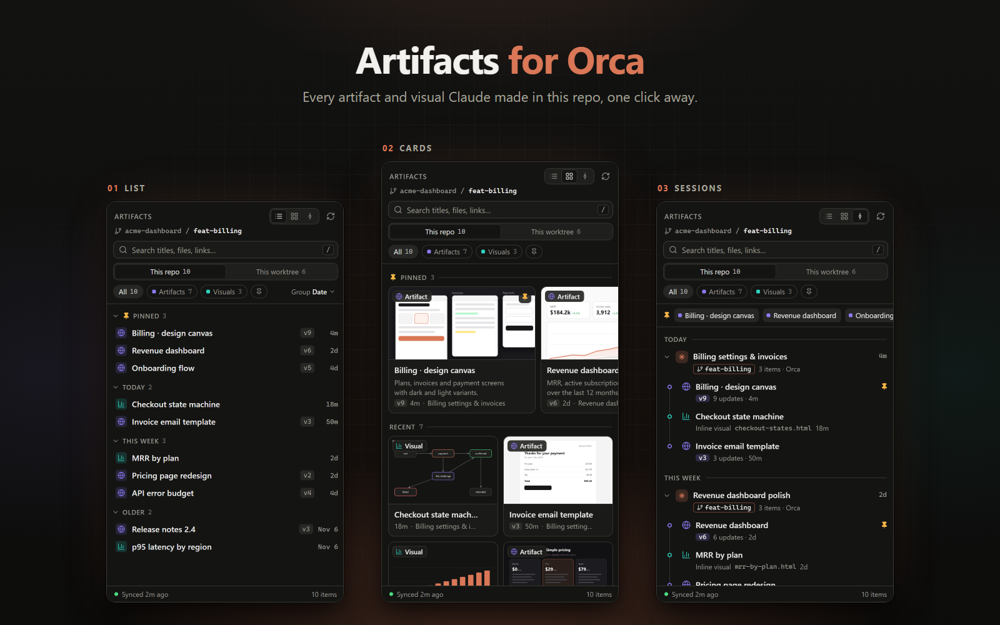

# Artifacts for Orca

<p align="center">
  
</p>

An [Orca](https://orca.dev) plugin that adds an **Artifacts** tab to the right sidebar. It lists what Claude made in the focused worktree's repo and opens each item in Orca's browser with one click:

- **claude.ai Artifacts** published with Claude's Artifact tool (design canvases, dashboards, reports).
- **Orca chat visuals**, the inline HTML pages shown in Orca's native chat.

Three views: **List** (grouped by date or session), **Cards** (preview per item, pinned rail) and **Sessions** (timeline per chat, with version history). Scope is the whole repo (all local worktrees) or just the focused worktree. Items can be pinned, copied and opened in the external browser.

## Install

Install it from its page on [orca.dev](https://orca.dev/plugins/santii90/orca-plugin-artifact-viewer), or in Orca go to **Settings → Plugins → Add plugin → From a Git URL** and paste `https://github.com/santii90/orca-plugin-artifact-viewer`. From a terminal:

```sh
orca plugin install santii90/orca-plugin-artifact-viewer
```

Orca asks you to approve it first, because its worker runs with your user's access to read local Claude Code transcripts (see [Privacy](#privacy)). Then open the **Artifacts** tab in the right sidebar.

Needs Orca 1.4.259 or newer. Updates from the community catalog are installed from Orca's plugin settings.

## How it works

A trusted worker (`src/worker.ts`) indexes Claude Code transcripts (`~/.claude/projects/**/*.jsonl`) incrementally and caches the index on disk (`%LOCALAPPDATA%\orca-artifacts` on Windows, `~/.cache/orca-artifacts` elsewhere). It reads only successful Artifact `publish` results and `::orca-visual` directives. Opening an item runs `orca tab create --url … --worktree path:…` and brings the new tab to the front. The panel (`panel/`) is plain HTML/JS talking to the worker through `plugin.request`; `src/protocol.ts` and `src/types.ts` define the contract.

Access requested: read workspaces and agent status, own storage and settings.

Settings: `cliPath` (Orca CLI, auto-detected), `claudeDirs` (Claude config folders, auto-detected), `visualPreviews` (card previews, on by default) and `browserPath` (Edge/Chrome for visual previews, auto-detected).

## Privacy

Everything stays on your machine; the plugin uploads nothing.

Card previews are captured locally and stored in the cache folder (`thumbs/`, capped at about 300 files / 30 MB). A claude.ai artifact is captured only when you open it from the panel, as a screenshot of its tab in Orca's browser. A chat visual is rendered by a headless Edge/Chrome with its own throwaway profile, no sandbox flags removed, no proxy, WebRTC restricted, and network access limited to Orca's CDN allowlist (jsDelivr, unpkg, cdnjs, esm.sh, Google Fonts). Turn off the `visualPreviews` setting to disable all capturing; a full refresh deletes stored previews.

Limitations: local workspaces only (no SSH/WSL); artifacts on claude.ai are private, so Orca's browser must be signed in to claude.ai to show them.

## Develop

```sh
orca plugin validate .
orca plugin test .            # node:test suites for indexer, worker, CLI, scope and panel logic
orca plugin dev watch .       # load into Orca (asks for approval), stream logs, reload on save
orca plugin dev request . artifacts.list --data '{"scope":"repo"}'
```

CI (`.github/workflows/ci.yml`) runs the checks that don't need Orca: panel tests, JS syntax and manifest/release rules. `orca plugin test` needs the Orca CLI, so run the full gate locally before tagging:

```sh
node scripts/release-check.mjs            # validate, tests, typecheck, manifest/tag checks
```

### Releasing

1. Bump `version` in `orca-plugin.json` and commit.
2. `node scripts/release-check.mjs`
3. `git tag v<version> && git push origin v<version>`; the community directory lists the new tag within about an hour.

Versions are immutable: never move or reuse a tag. Adding capabilities, panels, events, commands or hooks makes Orca ask users to approve the update again.

## License

MIT
